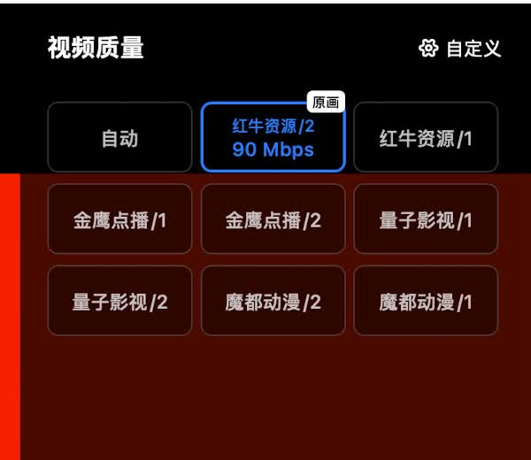

# 飞牛来源菜单显示验收

日期：2026-11-22，Asia/Shanghai。用户截图显示飞牛“视频质量”的三列按钮中，长源名加“画质待识别”等后缀溢出并互相遮挡；用户明确允许在无法稳定显示时删除画质后缀。

## 显示修正

客户端控制按钮宽度，服务端协议没有字体大小、自动缩小或换行设置。采用用户允许的方案：原生菜单只显示源名与必要的线路编号，例如 `红牛资源/2`，已知和未知画质都不追加到标签。省略源名前的 `🎬` 图标，订阅中保存的名称保持原样。

来源列表、起播菜单及当前来源标签共用同一函数。真实画质探测及从高到低的排序保留，未知画质排后；完整尺寸、编码、帧率和实际码率仍在媒体详情中提供，网页播放页的画质显示保留。选择码、播放地址、HLS 交付、权限及观看记录逻辑没有修改，也不需要数据库迁移。

## 验证结果

Rust 集成测试 **55 项**、AES 单元测试 **2 项**，共 **57 项**通过；`cargo fmt`、Clippy（警告视为错误）及本地构建通过。更新现有来源测试的标签断言，使用带电影图标的真实源名称，确认多线路区分、1080p／720p／360p／未知的顺序及媒体详情中的真实尺寸；失效来源测试按选择码定位，继续确认换源失败保留旧播放。

使用已安装飞牛播放器 **1.12.3 / 1123003**，运行于 Mac 的 iPhoneOS 兼容环境，连接独立测试数据库与本地受控媒体。实际打开播放中的三列“视频质量”菜单，8 条来源及线路标签没有跨列或互相遮挡：

| 原生标签               | 媒体探测尺寸 | 排序位置 |
| ---------------------- | ------------ | -------- |
| 红牛资源/1、红牛资源/2 | 1920 × 1080  | 最前     |
| 金鹰点播/1、金鹰点播/2 | 1280 × 720   | 第二组   |
| 量子影视/1、量子影视/2 | 640 × 360    | 第三组   |
| 魔都动漫/1、魔都动漫/2 | 未知         | 最后     |

同画质内部顺序沿用稳定媒体身份，表中没有要求线路 1 必须在前。已知及未知菜单项均没有画质后缀。数据库核对确认订阅名称仍含原有图标；夹具收到的媒体请求没有本站 Cookie、Authorization 或 Authx。

本轮只验收标签显示，没有重新计入所有媒体格式和播放中换源的手动验证；既有 HLS、AES-128、RPC 换源、删除记录及账号权限回归均在上述测试中通过。本轮没有连接用户的实体 iPhone，也没有更新用户运行中的部署。

证据目录为 `tmp/fntv-menu-labels-20261122-E5nHz8/`，包含 `native-menu-short-labels.jpg`、对应的界面文本、`verification.json`、`native-requests.jsonl` 和 `media-requests.jsonl`。检查日志在 `tmp/fntv-menu-labels-20261122/`。临时客户端与服务在发布前停止。

## 发布验证

功能提交 `1301612941f42b6f70e64e7a7b673099bf135c45` 已推送 `main`。[GitHub Actions](https://github.com/lengyuesky/tv-rust/actions/runs/44979985784) 全部成功：检查与网页构建 1 分 11 秒，AMD64 原生构建及启动检查 1 分 36 秒，ARM64 1 分 52 秒，合并发布 20 秒，完整流程 **3 分 31 秒**。沿用免费标准 runner 的双架构并行构建流程。

独立核对 GHCR：`ghcr.io/lengyuesky/tv-rust:latest` 与 `sha-1301612941f42b6f70e64e7a7b673099bf135c45` 指向相同索引，仅包含 `linux/amd64`、`linux/arm64`。两架构的 OCI 源码修订标签均为本次功能提交，镜像运行用户为 `tv`。索引摘要为 `sha256:091daaff03ebf23304dfa12852af535138c22a6912d40f61e6a9767dba329b88`。

发布证据为 `tmp/fntv-menu-labels-20261122/` 下的 `ci-run.json`、`ci-verification.json`、`ci.log`、`image-latest.json`、`image-sha.json`、`image-configs.json` 和 `image-verification.json`。镜像已发布，用户运行中的部署尚未更新；本验收文档的后续提交不触发镜像重建。

## 更新后使用

在现有 Compose 目录运行 `docker compose pull` 和 `docker compose up -d`，退出旧播放并重新进入，生成新版来源菜单。画质菜单按真实画质排序，点击源名即可换源；完整画质在“文件位置／视频信息”查看。
